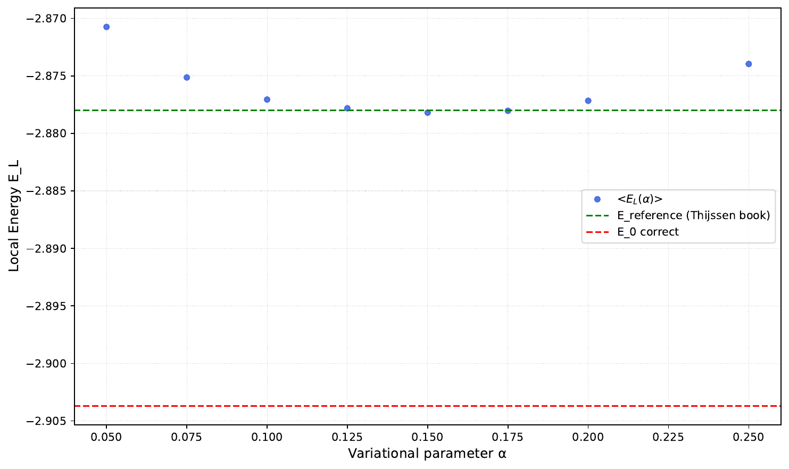

# Variational Monte Carlo

Variational Monte Carlo simulation for the harmonic oscillator, hydrogen and helium (Python/NumPy).

## Context

Reproducing the variational Monte Carlo chapter of
J. Thijssen, *Computational Physics*, 2nd ed., Cambridge University Press (2007), ISBN 978-0-521-83346-2.

## Method

- Choose a trial wavefunction $\psi_\alpha$ with a variational parameter $\alpha$.
- Sample configurations from $|\psi_\alpha|^2$ with the Metropolis algorithm (vectorised walkers).
- Average the local energy $E_L = \frac{H\psi_\alpha}{\psi_\alpha}$ and minimise $\langle E \rangle$ over a grid of $\alpha$.

## Results

| System | Optimal $\alpha$ | $\langle E \rangle \pm \sigma$ | Reference $E_0$ |
|---|---|---|---|
| Harmonic oscillator (1D) | 0.50 | $0.50000 \pm 0$ | $0.5$ (exact) |
| Hydrogen | 1.00 | $-0.50000 \pm 0$ | $-0.5$ (exact) |
| Helium | 0.15 | $-2.8782 \pm 0.335$ | $-2.9037$ (exact), $-2.8781$ (Thijssen) |

Energies in natural / atomic units. $\sigma = \sqrt{\mathrm{var}(E_L)}$ is the spread of the local energy, not the
statistical error of the mean. Full $\alpha$ scans are in [`report/tables/`](report/tables/).



## Run

```bash
pip install -r requirements.txt
jupyter notebook main.ipynb
```

## Report

[Full report (PDF)](report/vmc_project_report_mayer.pdf)
